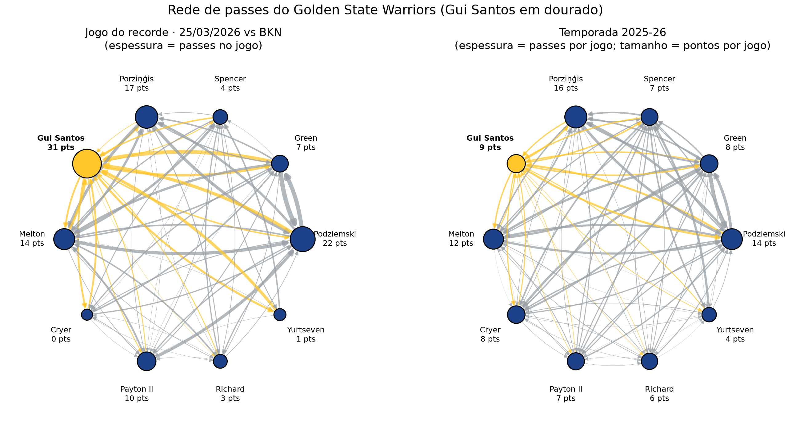
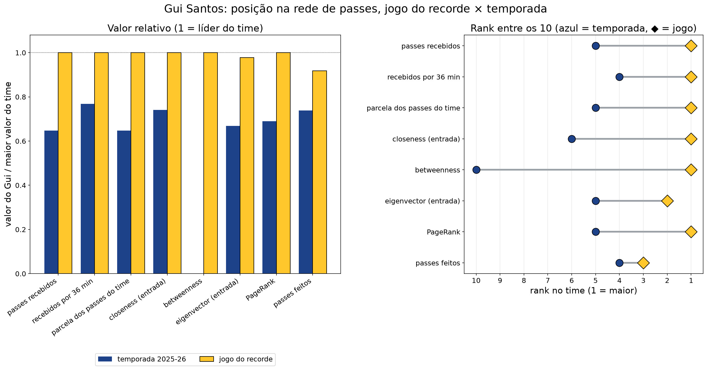
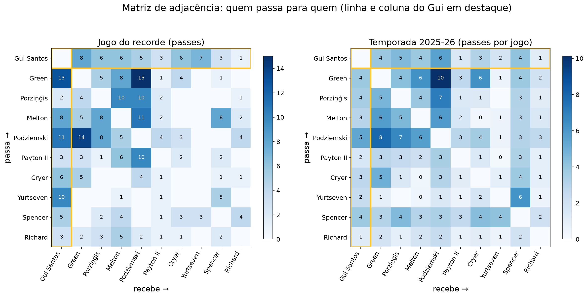
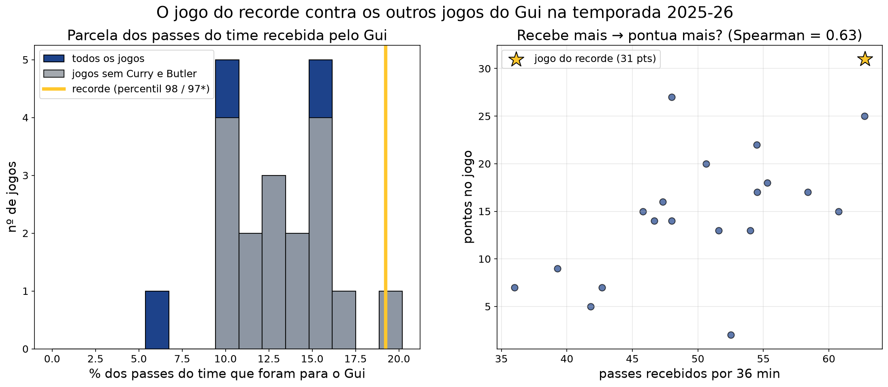
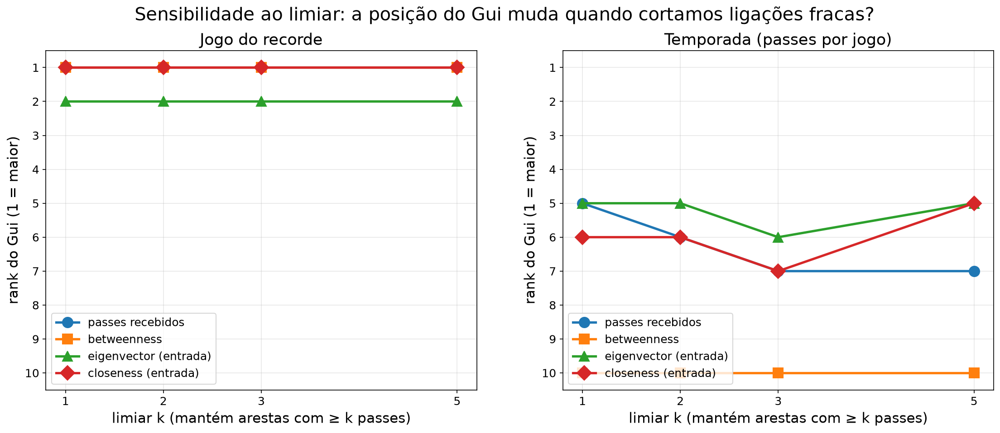

# A bola passou pelo Gui? Rede de passes do Golden State Warriors no jogo do recorde de Gui Santos

## Integrantes
**[COLOQUE AQUI OS NOMES COMPLETOS DE TODOS OS INTEGRANTES]** · Nome Completo 2 · Nome Completo 3

## Vídeo
**LINK_DO_VIDEO_AQUI** (até 15 min no total)

## Problema e pergunta

Em 25/03/2026, o brasileiro **Gui Santos** fez **31 pontos** (11/16 nos arremessos, 4/6 de três, em 35 min) na vitória do Golden State Warriors sobre o Brooklyn Nets por 109 x 106. É o recorde da carreira dele.

**Pergunta:** *No jogo do recorde do Gui Santos, a bola passou a fluir por ele (o time jogou para ele) ou ele pontuou fora da estrutura de passes do time?*

**Quem se beneficia:** a comissão técnica e o scouting, que querem saber se o resultado é **repetível** (efeito estrutural: o sistema o procurou) ou uma **noite fora da curva** (efeito individual: ele criou sozinho).

**Por que a pergunta só faz sentido em rede:** o box score diz quantos pontos ele fez, mas não diz se a bola chegava até ele nem por quem ela passava. Isso é estrutura: centralidade (ele virou destino e ponte da bola?), posição no núcleo (ele estava no miolo das ligações fortes?) e dependência (a circulação piora sem ele?). E tudo isso precisa ser comparado com uma linha de base, que é a mesma rede na temporada.

## Dados

**Fonte:** stats.nba.com, a base oficial da NBA, com o rastreamento óptico de jogadores (Second Spectrum), acessada pela biblioteca [`nba_api`](https://github.com/swar/nba_api). Os dados são reais, de um jogo real, sem nada simulado.

**Como obter** (`src/coleta.py`, função `coletar_tudo`):
1. `players.find_players_by_full_name("Gui Santos")` → PLAYER_ID 1630611. Depois, `playercareerstats` + `playergamelog` para cada temporada (regular e playoffs) → 157 jogos na carreira. O jogo com mais pontos é o **GAME_ID 0022501060** (25/03/2026, GSW vs. BKN, 31 pts).
2. `boxscoretraditionalv3` (quem entrou em quadra, minutos, pontos) e `commonteamroster` (posição).
3. **Rede do jogo:** `playerdashptpass` com `DateFrom = DateTo = 03/25/2026` e `TeamID` do GSW, um request por jogador que entrou em quadra. O resultado `PassesMade` dá as arestas passador → recebedor (PASS, AST, FGM, FGA).
4. **Rede de referência:** o mesmo endpoint sem filtro de data (temporada regular 2025-26 inteira), para os mesmos 10 jogadores. Os pesos são normalizados para passes por jogo.
5. **Distribuição (melhoria):** `playerdashptpass` do Gui e `teamdashptpass` do GSW em cada data em que o Gui jogou na temporada, mais o `playergamelog` de Curry e Butler para identificar os jogos sem eles. **Amostra parcial:** o stats.nba.com limitou a taxa de requests (cerca de 40 s por jogo, com bloqueios intermitentes), então a análise usa os **20 jogos** coletados (28/02 a 12/04/2026, todos com 10 min ou mais). `coletar_tudo()` completa os 68 jogos quando houver tempo.

A coleta usa headers de navegador, `timeout=60`, retry com backoff exponencial e pausa de 0,6 s entre requests. JSONs brutos ficam em `data/raw/` e tabelas limpas em `data/processed/` (ambos no repositório). **Nota técnica:** o stats.nba.com passou a recusar silenciosamente (timeout) a impressão digital TLS da biblioteca `requests`. Por isso, a sessão HTTP da `nba_api` foi trocada por uma do [`curl_cffi`](https://github.com/lexiforest/curl_cffi), que imita o Chrome (`coleta._configurar_sessao`). Endpoints e parâmetros continuam sendo os da `nba_api`. O plano B (rede de assistências do play-by-play) não foi necessário, porque o rastreamento de passes veio completo para o jogo.

**Limpeza:**
- **Nós = os 10 jogadores do GSW com minutos > 0.** Moses Moody e Quinten Post ficaram fora (DND por lesão). **Stephen Curry e Jimmy Butler não estavam no jogo.**
- Arestas identificadas por `PLAYER_ID`, porque a API escreve os nomes como "Sobrenome, Nome" e com acentos (Porziņģis).
- **Checagem de consistência:** os passes A→B vistos pelo lado de A (`PassesMade`) e pelo lado de B (`PassesReceived`) batem em 68 de 68 pares (diferença 0).
- No jogo, nenhum passe foi para quem não estava em quadra. Na temporada, **40,2%** dos passes desses 10 jogadores foram para quem não jogou essa partida (Curry 1.555, Butler 1.050, Horford 922...). Esses passes foram descartados da rede de referência para manter o mesmo conjunto de nós (e contabilizados no notebook).
- **Normalização da temporada:** passes A→B na temporada ÷ `min(jogos de A, jogos de B)`, uma aproximação dos jogos em que o par poderia jogar junto. Sem isso, Porziņģis (15 jogos pelo GSW) e Yurtseven (9) pareceriam periféricos só por terem chegado tarde.
- Yurtseven jogou só 7 min. Ele fica na rede porque estava em quadra, mas as medidas dele são instáveis.

## Modelagem

| Elemento | Escolha | Por quê |
|---|---|---|
| **Nó** | jogador do GSW que entrou em quadra (10) | atributos: minutos, pontos, posição |
| **Aresta** | **dirigida**, A → B se A passou para B | passar e receber são papéis diferentes no basquete |
| **Peso** | nº de passes (jogo) ou passes por jogo (temporada) | versão alternativa: **assistências** (o passe virou cesta) |
| **Distância** | `1 / passes` | muitos passes = ligação "curta"; usada em caminhos, closeness e betweenness |
| **Versão não dirigida** | peso(A,B) = A→B + B→A | para clustering e k-core, definidos em grafos não dirigidos |

**O que ficou de fora e por quê:** os **adversários** (a pergunta é sobre a estrutura interna do ataque do GSW); a **ordem e o momento** dos passes (o rastreamento é agregado por par, não sequencial, então não dá para reconstruir posses); passes **não registrados** pelo rastreamento; **rebotes, roubos e jogadas individuais** (não são passes, e é exatamente isso que a pergunta tenta separar).

**Alternativas de modelagem discutidas no notebook:** contagem bruta vs. normalizada por minuto/por jogo; dirigida vs. não dirigida; peso = passes vs. peso = assistências; **esqueleto por limiar** k ∈ {1, 2, 3, 5}.

## Conteúdo do curso utilizado

Os números são o contador de execução `[N]` da célula de código em `analise.ipynb`.

| conceito | semana | onde aparece | para que serviu |
|---|---|---|---|
| grafo dirigido ponderado (`DiGraph`) com atributos nos nós | 2 | `analise.ipynb`, cél. [5] | nó = jogador, aresta A→B = passe; a direção separa quem distribui de quem recebe |
| número de nós/arestas, densidade, reciprocidade | 2 | `analise.ipynb`, cél. [6] | densidade 0,76 no jogo: quase todo mundo passa para quase todo mundo, então é o **peso** (nº de passes) que diferencia os jogadores |
| matriz de adjacência (heatmap) | 2 | `analise.ipynb`, cél. [7] | "quem passa para quem": a coluna do Gui (passes recebidos) é a mais carregada do jogo |
| grau e distribuição de grau (entrada/saída) | 2 | `analise.ipynb`, cél. [8] | nº de companheiros distintos: o Gui recebeu passes de todos os 9 em quadra |
| atributos das arestas (AST, FGA após o passe) | 2 | `analise.ipynb`, cél. [21] | cesta assistida = criada pelo passe de um companheiro, ou seja, ponto que veio "de dentro" da rede |
| grau de entrada e de saída ponderados (força), por 36 min | 3 | `analise.ipynb`, cél. [9] | força de entrada = quanto a bola chega ao jogador; de saída = quanto ele distribui; por 36 min tira o efeito dos minutos |
| núcleo e periferia | 3 | `analise.ipynb`, cél. [9] | núcleo = quem concentra a circulação (força total acima da mediana); periferia = quem só complementa |
| BFS e DFS | 3 | `analise.ipynb`, cél. [11] | camadas a partir do Gui no esqueleto de passes fortes (≥5): a quantos passes cada companheiro está dele |
| amostragem snowball | 3 | `analise.ipynb`, cél. [11] | ondas a partir do Gui seguindo passes fortes: até onde a bola vai partindo dele |
| componentes (WCC, SCC) | 4 | `analise.ipynb`, cél. [12] | uma única SCC: a bola consegue ir de qualquer jogador a qualquer outro |
| caminhos, distâncias e diâmetro | 4 | `analise.ipynb`, cél. [12] | diâmetro 2; a distância ponderada (1/passes) média **até** o Gui é a menor do time, ou seja, a bola chega "mais perto" dele |
| eficiência global (não ponderada e ponderada) | 4 | `analise.ipynb`, cél. [12] | facilidade de a bola circular; base para medir quanto o ataque depende de um jogador |
| centralidade de grau | 4 | `analise.ipynb`, cél. [13] | com quantos companheiros o jogador troca passes |
| closeness de entrada (distância = 1/passes) | 4 | `analise.ipynb`, cél. [13] | closeness alta = a bola chega rápido ao jogador saindo de qualquer companheiro |
| betweenness (distância = 1/passes) | 4 | `analise.ipynb`, cél. [13] | betweenness alta = jogador por onde a bola precisa passar para ir de um lado ao outro do ataque |
| eigenvector (arestas de entrada) e PageRank | 4 | `analise.ipynb`, cél. [13] | prestígio: recebe passes de quem também é muito procurado (os "jogadores de confiança") |
| triângulos e clustering (não dirigido, ponderado) | 4 | `analise.ipynb`, cél. [13] | quanto os parceiros de passe do jogador também trocam passes entre si (triangulações) |
| visualização da rede (layout circular) | 4 | `analise.ipynb`, cél. [14] | espessura = passes, tamanho = pontos, Gui em dourado: jogo e temporada lado a lado |
| nxviz (CircosPlot e MatrixPlot) | 4 | `analise.ipynb`, cél. [15] | a ferramenta de visualização mostrada no curso, aplicada à rede do jogo |
| robustez (remoção de nó, eficiência) | 4 | `analise.ipynb`, cél. [18] | quanto a circulação piora sem o Gui, comparado com tirar o jogador mais central (Podziemski) e com tirar qualquer outro |
| comparação de centralidades entre duas redes (ranks) | 4 | `analise.ipynb`, cél. [19] | **a resposta da pergunta:** a posição do Gui no jogo do recorde vs. na temporada |
| k-core, core number, degeneracy, onion layers | 5 | `analise.ipynb`, cél. [16] | o Gui está no miolo mais coeso das ligações do time ou na borda? |
| k-truss | 5 | `analise.ipynb`, cél. [16] | coesão por triângulos: grupos em que cada par de passe faz parte de várias triangulações |
| k-core no esqueleto por limiar | 5 e 6 | `analise.ipynb`, cél. [17] | quem continua no núcleo quando só as ligações fortes contam |
| esqueleto por limiar (k ∈ {1,2,3,5}) | 6 | `analise.ipynb`, cél. [23] | a conclusão não depende de onde cortamos as arestas fracas? |
| similaridade de Jaccard | 6 | `analise.ipynb`, cél. [24] | quanto do esqueleto de passes do jogo é o mesmo da temporada, na rede toda e nas arestas do Gui |
| modelagens alternativas: peso = assistências; não dirigida | 2 e 4 | `analise.ipynb`, cél. [26] | a resposta muda se o peso for assistência ou se ignorarmos a direção? |

**Não usados, e por quê:** redes bipartidas, projeção e matriz de incidência (semana 6) não se aplicam a uma rede de passes jogador→jogador sem um segundo tipo de nó (forçar uma bipartição jogador–posse exigiria dados sequenciais que o rastreamento não fornece); multigrafo (semana 2): os passes repetidos entre o mesmo par viraram **peso** em vez de arestas paralelas, o que é equivalente e mais simples; Gephi (opcional) foi substituído pelo matplotlib/nxviz para manter tudo reprodutível pelo código.

## Como executar

Requisitos: Python 3.12 e git. Em uma máquina limpa:

```bash
git clone https://github.com/VitorRayan/rede-passes-gui-santos.git
cd rede-passes-gui-santos
python -m venv .venv
# Windows: .venv\Scripts\activate    |    Linux/macOS: source .venv/bin/activate
pip install -r requirements.txt
jupyter nbconvert --to notebook --execute analise.ipynb --output analise.ipynb
```

- Com `BAIXAR_DADOS = False` (padrão, 1ª célula do notebook), tudo roda a partir dos CSVs de `data/processed/`, sem acessar a internet. Leva cerca de 1 minuto.
- Com `BAIXAR_DADOS = True`, a coleta é refeita na API da NBA (alguns minutos para a rede; cerca de 1 h para a distribuição por jogo, por causa do limite de taxa do servidor). Os JSONs já presentes em `data/raw/` servem de cache.
- Todas as figuras de `figures/` são regeneradas pelo notebook.
- Testado em um venv novo (Windows 11, Python 3.12.10) com o comando acima, a partir de um `git clone` novo e com `figures/` apagada: **26 células executadas, 0 erros, 9 figuras regeneradas, ~30 s** (20/10/2026).

## Resultados

**Resposta direta:** **O time jogou para ele.** No jogo do recorde, a bola fluiu pelo Gui mais do que por qualquer companheiro. Ele foi o 1º do time em passes recebidos (61, ou 19% de todos os passes do GSW, e continua 1º por 36 minutos), em betweenness, closeness de entrada e PageRank, e o 2º em eigenvector. Na temporada, ele fica entre o 4º e o 6º nessas mesmas medidas, com betweenness zero. Comparado com os outros 20 jogos dele que coletamos, foi o jogo em que ele mais recebeu a bola (percentil 98), inclusive entre os jogos sem Curry e Butler. **A ressalva:** a estrutura levou a bola até ele, mas ele converteu com mais criação própria do que o normal: 55% das cestas foram assistidas, contra 77% na temporada. E o contexto ajudou, porque Curry e Butler estavam fora. Para o scouting, o efeito é **estrutural, mas condicionado aos desfalques**.

| Medida (Gui entre os 10) | Jogo do recorde | Temporada |
|---|---|---|
| passes recebidos | **61 (1º)** | 27,5 por jogo (5º) |
| passes recebidos por 36 min | **62,9 (1º)** | 48,2 (4º) |
| parcela dos passes do time que foram para ele | **19,2% (1º)** | 10,7% (5º) |
| betweenness (distância = 1/passes) | **0,326 (1º)** | 0,000 (empatado em último) |
| closeness de entrada | **1º** | 6º |
| eigenvector de entrada | 0,480 (2º, colado no Podziemski: 0,491) | 0,319 (5º) |
| PageRank | **0,172 (1º)** | 0,107 (5º) |
| passes feitos | 45 (3º) | 29,4 por jogo (4º) |
| queda da eficiência global ao remover o jogador | **15,6%** (= remover Podziemski; média dos outros 8: −1,8%) | 0,5% (Podziemski: 12,6%) |
| % das cestas que foram assistidas | 55% (6 de 11) | 77% |











**Leitura dos resultados, seção por seção do notebook:**

- **Descrição (sem. 2):** 10 nós, 68 arestas e 317 passes no jogo; densidade 0,76 e reciprocidade 0,91. Como quase todos passam para quase todos, o **grau sem peso não discrimina** (o Gui recebeu de todos os 9 companheiros, assim como Payton II). O que discrimina é o peso. No heatmap, a coluna do Gui é a mais carregada: Green → Gui (13), Podziemski → Gui (11), Yurtseven → Gui (10).
- **Entrada e saída (sem. 3):** o Gui recebeu 61 passes e fez 45. Ele foi mais **destino** do que distribuidor, ao contrário de Green e Payton II, que passam mais do que recebem. O confundidor "minutos" não explica isso: por 36 min ele continua em 1º (62,9 contra 58,8 de Melton e 58,4 de Podziemski). Seis companheiros passaram para ele 5 vezes ou mais (BFS/snowball no esqueleto ≥5).
- **Componentes e caminhos (sem. 4):** uma única SCC, diâmetro 2, distância média de 1,24 salto. A distância ponderada média **até** o Gui (0,163) é a menor do time, ou seja, a bola chegava a ele por caminhos "curtos" (com muitos passes).
- **Centralidades (sem. 4):** na temporada, a betweenness se concentra em Podziemski, Spencer e Green, e o Gui tem zero. No jogo, ele passa a ser a principal ponte (0,326), à frente de Podziemski (0,312).
- **Núcleos (sem. 5):** sem limiar, todos estão no 6-core (a rede é densa demais para separar alguém). No **esqueleto por limiar**, o Gui permanece no núcleo mais coeso até com ≥8 passes por par (4-core), junto com Green, Podziemski, Melton e Porziņģis. O maior **k-truss** com ligações ≥5 é um 5-truss formado exatamente por esses 5 jogadores.
- **Robustez:** remover o Gui derruba a eficiência ponderada em 15,6% e leva 33% dos passes junto, **o mesmo efeito de remover Podziemski**, o organizador do time. Remover qualquer outro jogador praticamente não muda a eficiência (−1,8% em média). Na rede da temporada, remover o Gui custa só 0,5%. Naquela noite, o ataque dependia dele.
- **Distribuição (melhoria):** em 20 jogos do Gui (28/02 a 12/04/2026), o recorde é o **maior** em passes recebidos, recebidos por 36 min e parcela do time (19,2% contra mediana de 12,7%). Isso continua valendo entre os 17 jogos sem Curry e Butler. Entre jogos, receber mais está associado a pontuar mais (Spearman de 0,63 com passes recebidos por 36 min; 0,75 com passes recebidos).
- **Sensibilidade ao limiar (sem. 6):** com k = 1, 2, 3 e 5, o Gui continua em 1º em passes recebidos, betweenness e closeness, e em 2º em eigenvector, na rede do jogo. Na temporada, fica entre o 5º e o 7º. **A conclusão não depende do limiar.** Jaccard: com k = 5, só 17% das ligações fortes do Gui no jogo também são ligações fortes na temporada (12 no jogo contra 2 na temporada), então foi uma estrutura nova em volta dele.
- **Modelagens alternativas:** com peso = assistências, o Gui foi o jogador mais assistido (6 de 21 assistências do time). Na versão **não dirigida**, a betweenness dele cai para 0,278 e Podziemski passa à frente (0,306). Ignorar a direção esconde justamente o papel de **receptor**, o que justifica o modelo dirigido.
- **Nuance importante (atributos das arestas):** todos os 16 arremessos do Gui vieram depois de receber um passe (nenhum de rebote ofensivo ou roubo), mas só 6 das 11 cestas foram assistidas. Ou seja, ele recebia e muitas vezes criava a partir daí (drible, isolação). O time escolheu **dar a bola** a ele; a finalização teve mais mérito individual do que o normal.

Outras figuras: `figures/05_distribuicao_grau.png`, `06_entrada_saida_por36.png`, `07_kcore_por_limiar.png`, `09_nxviz_circos_matrix.png`.

## Limitações e próximos passos

| Limitação | Por que importa | Como contornar |
|---|---|---|
| **n = 1 jogo** | uma noite pode ser ruído | já parcialmente contornado: o recorde comparado com a distribuição de 20 jogos do Gui (amostra parcial; completar os 68); próximo passo: rede completa (10 jogadores × 68 jogos) e centralidades por jogo |
| **Rastreamento agregado** (sem sequência nem momento dos passes) | não dá para saber se os passes ao Gui vieram em posses decisivas, nem reconstruir cadeias A→B→C | usar o play-by-play (`playbyplayv3`) para fatiar por quarto/posse, ou dados de tracking sequencial |
| **Minutos em quadra confundem as medidas** | quem joga mais passa e recebe mais (o Gui jogou 34,9 min, 2º maior tempo) | força por 36 min e parcela dos passes do time (feito); o ideal seria normalizar por minutos **em quadra juntos** de cada par (dados de lineups) |
| **Garbage time** | minutos sem disputa inflam ou distorcem passes | o jogo foi decidido por 3 pontos, então o efeito aqui é pequeno; na distribuição filtramos jogos com 10 minutos ou mais; próximo passo: remover posses com diferença acima de 20 pontos via play-by-play |
| **Adversário e contexto (desfalques)** | **Curry e Butler estavam fora**, o que libera posses e passes para os outros | percentil calculado também só entre jogos sem Curry e Butler (feito); próximo passo: controlar pela defesa adversária (rating defensivo do BKN) |
| **Passe ≠ qualidade do passe** | 10 passes na linha de três sem marcação ≠ 10 passes de segurança | usar `FGA`/`AST` das arestas (feito em parte) e dados de "potential assists"/qualidade de arremesso |
| **Sensibilidade ao limiar** | a resposta pode depender de onde se corta a aresta fraca | testado com k ∈ {1, 2, 3, 5}: a conclusão se mantém (seção 8) |
| **Versão não dirigida em k-core e clustering** | somar A→B + B→A apaga a diferença entre passar e receber | comparamos dirigida × não dirigida para betweenness/eigenvector; próximo passo: k-core dirigido (in-core/out-core) e s-core ponderado |
| **Rede de referência sem as estrelas** | 40% dos passes da temporada (para Curry, Butler etc.) ficaram fora para manter os mesmos nós | próximo passo: rede de temporada com todos os jogadores e o Gui medido nela |
| **Normalização por `min(jogos)`** | aproxima, mas não mede, quanto tempo cada par jogou junto | dados de lineups (`teamdashlineups`) |

## Referências

- Swar Patel et al. **nba_api**: cliente Python para as APIs do NBA.com. https://github.com/swar/nba_api (documentação dos endpoints `playerdashptpass`, `teamdashptpass`, `playergamelog`, `boxscoretraditionalv3`).
- NBA.com/Stats: **Passing Dashboard** (rastreamento Second Spectrum). https://www.nba.com/stats/players/passing
- Hagberg, A., Schult, D., Swart, P. **NetworkX**: Exploring network structure, dynamics, and function. SciPy 2008. https://networkx.org/documentation/stable/
- Ma, E. **nxviz**: rational network visualization. https://github.com/ericmjl/nxviz
- Latora, V., Marchiori, M. Efficient behavior of small-world networks. *Physical Review Letters*, 87(19), 2001 (eficiência global).
- Material da disciplina Algoritmos e Estrutura de Dados II (Grafos), UFRN/DCA, prof. Ivanovitch Silva, semanas 2 a 6.
- lexiforest. **curl_cffi**. https://github.com/lexiforest/curl_cffi
